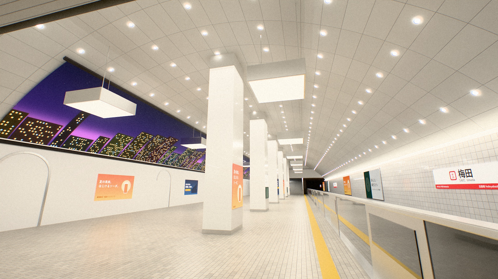

# inside-the-station

日本の地下鉄駅にある白タイルの連絡通路を、Blender（Cycles パストレーサ）でコードから生成した静止画です。
空間・素材・照明・ポスター・看板はすべてこのリポジトリのスクリプトで作っています。
3Dモデル素材、テクスチャ素材、写真は使っていません。
ポスターと看板は架空の「陽ヶ丘地下鉄」のものとしてデザインしたオリジナルです。


## 構成

| ファイル | 内容 |
|---|---|
| `scripts/textures.py` | タイル・床・天井・点字ブロックの質感（色・粗さ・法線）を numpy で生成します。タイルの丸い縁、1枚ごとの傾きや色のばらつき、目地の凹み、壁下部の汚れ、床の擦れ跡を含みます |
| `scripts/graphics.py` | ポスター6種、出口看板、乗換看板、誘導灯、扉の表示板、消火栓の表示を Pillow で描画します |
| `scripts/build_scene.py` | 通路・設備・照明・カメラを組み立てて Cycles でレンダリングします（出力は線形 EXR） |
| `scripts/post.py` | 発光のにじみ、レンズのベール、色収差、周辺減光をかけたあとトーンマッピングし、粒子感を加えます |

## 再現手順

```bash
pip install bpy==5.3.0 numpy scipy pillow
scripts/fetch_fonts.sh                      # Noto Sans/Serif JP など（OFL）
cd scripts
python3 build_scene.py --out ../render/corridor.exr --width 1920 --samples 400 --noise 0.008 --texres 4096
python3 post.py ../render/corridor.exr ../render/corridor.png --exposure -0.5 --view "Khronos PBR Neutral" --look None
```

GPU のない4コアの CPU で、1920×1080・400サンプルのレンダリングに約40分かかりました（実測2357秒）。

---

# 梅田駅（Osaka Metro 御堂筋線）の再現

Osaka Metro が公開している公式の駅構内図をもとに、梅田駅の B1 コンコースと B2 ホームを3Dで組み立てました。




## 元にした資料

| 資料 | 使った内容 |
|---|---|
| Osaka Metro「避難確保・浸水防止計画 御堂筋線 梅田駅」(2018) 9ページ「駅構内 避難経路図」 | 壁・柱・部屋の平面形、階段 A〜J の位置、改札の列、出入口の位置。上の図が B1 コンコース、下の図が B2 ホーム |
| Wikipedia「梅田駅 (Osaka Metro)」 | ホーム幅 24.5 m（1番線側 12.0 m、2番線側 12.5 m）、有効長 197 m / 201 m、島式1面2線、2番線南側のアーチ天井（2015年改修）、アーチ天井の LED スクリーン 40 m × 4 m（2019年）、可動式ホーム柵（2021年） |
| @DIME の記事写真（2018） | 2番線側のアーチ天井、丸い照明、線路側の白タイル壁と広告 |
| Impress Watch「Umeda Metro Vision」の写真（2019） | LEDスクリーンはアーチの仕切り壁側の半分にあること、アーチ状の扉が並ぶベージュの仕切り壁、アーチ面の有孔パネルと小さなダウンライトの列、吊り下げ照明、柱の広告 |
| Wikimedia Commons の写真（CC0 / CC BY ほか、参考として見ただけでリポジトリには含めていません） | 北改札内通路のボールト天井と階段、ホームの小型舗装タイル、改札機の色と形 |

縮尺は1ピクセルあたり 0.187 m です。地図上のホーム幅をホーム幅の公表値に合わせて決めました。
この縮尺だとホームの長さは約 204 m / 215 m となり、有効長の公表値とも合います。
2枚の図は同じ縮尺で横位置が揃っており、上下に 493 px ずれているだけです。
これは各階段の上端（B1）と下端（B2）の位置で確認しました。

## 地図から自動で取ったもの・手で指定したもの

- **自動**（`scripts/umeda/plan.py`）：赤い避難経路と文字を消した線画から、通れる床を塗りつぶしで求めます。それ以外の壁・柱・部屋をそのまま多角形にして立ち上げています。
- **手で指定**：階段 A〜J の範囲と昇り方向（地図の矢印から判断）、改札機の列、出入口の階段の向き、B1 の外周（地下街へ続く端を切るため）、アーチ天井の範囲です。

`render/umeda_top.png` は、地図と同じ縮尺・同じ配置で真上から撮った3Dモデルです。
`scripts/umeda/compare.py` を実行すると、地図の線を重ねた比較画像ができます（地図そのものを含むため、比較画像はリポジトリに入れていません）。

## 推定であるもの（地図にも公表値にもない）

- 高さ：コンコース天井 3.0 m（北改札内通路のボールト頂部 4.0 m）、ホーム床は B1 から −5.8 m、ホームの平天井 3.6 m、アーチの頂部はホーム床から 7.1 m、線路はホーム面から −1.1 m
- 仕上げ：床石、白タイル、天井材、柱の被覆、照明の配置、コンコースの内装
- 広告と LED スクリーンの映像は架空のものです。駅名標・番線案内・改札名は実際の案内情報をもとに描いています。

## 再現手順

```bash
scripts/umeda/fetch_map.sh                  # 公式PDFを取得し、9ページの図を cache/umeda/map.png に保存
python3 scripts/umeda/plan.py               # 地図を3D用の多角形に変換 → cache/umeda/plan.json
cd scripts/umeda
python3 build_umeda.py --view platform  --out ../../render/umeda_platform.exr  --width 1920 --samples 160 --noise 0.02
python3 build_umeda.py --view concourse --out ../../render/umeda_concourse.exr --width 1920 --samples 128 --noise 0.02
python3 build_umeda.py --view overview  --out ../../render/umeda_overview.exr  --width 1920 --samples 96 --noise 0.02
python3 build_umeda.py --view top       --out ../../render/umeda_top.exr       --samples 48
# 構図の検討用：低解像度で複数のカメラ位置を一度に描画（x,y,z,上下角,方位角,焦点距離）
python3 build_umeda.py --view platform --width 400 --samples 8 "--multi=40,-9.8,-4.2,13,-76,15;44,-2.5,-4.2,14,-100,14"
```

`pip install opencv-python-headless` も必要です。
