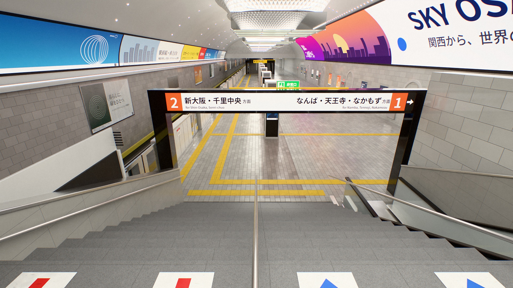
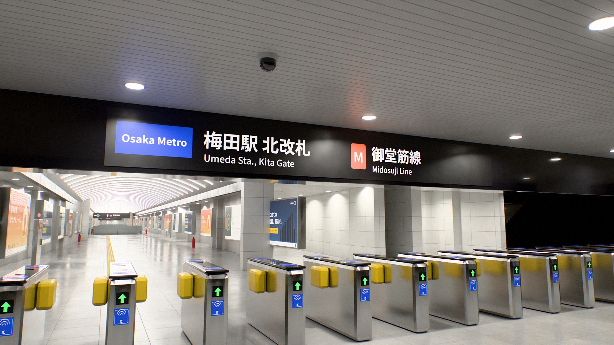

# inside-the-station

日本の地下鉄駅にある白タイルの連絡通路を、Blender（Cycles パストレーサ）でコードから生成した静止画です。
空間・素材・照明・ポスター・看板はすべてこのリポジトリのスクリプトで作っています。
3Dモデル素材、テクスチャ素材、写真は使っていません。
ポスターと看板は架空の「陽ヶ丘地下鉄」のものとしてデザインしたオリジナルです。


## 構成

| ファイル | 内容 |
|---|---|
| `scripts/textures.py` | タイル・床・天井・点字ブロックの質感（色・粗さ・法線）を numpy で生成します。タイルの丸い縁、1枚ごとの傾きや色のばらつき、目地の凹み、壁下部の汚れ、床の擦れ跡を含みます |
| `scripts/graphics.py` | ポスター6種、出口看板、乗換看板、誘導灯、扉の表示板、消火栓の表示を Pillow で描画します |
| `scripts/build_scene.py` | 通路・設備・照明・カメラを組み立てて Cycles でレンダリングします（出力は線形 EXR） |
| `scripts/post.py` | 発光のにじみ、レンズのベール、色収差、周辺減光をかけたあとトーンマッピングし、粒子感を加えます |

## 再現手順

```bash
pip install bpy==5.3.0 numpy scipy pillow
scripts/fetch_fonts.sh                      # Noto Sans/Serif JP など（OFL）
cd scripts
python3 build_scene.py --out ../render/corridor.exr --width 1920 --samples 400 --noise 0.008 --texres 4096
python3 post.py ../render/corridor.exr ../render/corridor.png --exposure -0.5 --view "Khronos PBR Neutral" --look None
```

GPU のない4コアの CPU で、1920×1080・400サンプルのレンダリングに約40分かかりました（実測2357秒）。

---

# 梅田駅（Osaka Metro 御堂筋線）の再現

Osaka Metro が公開している公式の駅構内図で、間取り（壁・柱・階段・改札・出入口の位置）を決めました。
内装・設備・照明は、実際の梅田駅の写真を見ながら作り直しました。
各カメラは、参照した写真とほぼ同じ位置と向きに置いています。

| 場所 | 参照した写真 |
|---|---|
|  2番線南側のアーチ天井（北を向いて撮影） | Commons「大阪メトロ梅田駅2番線ホーム2.jpg」ほか |
|  J階段の踊り場から見たアーチ側ホーム | Wikipedia「新大阪・箕面萱野方面ホーム（改修後）」 |
|  1番線側（平天井の部分） | Wikipedia「なかもず方面ホーム」 |
|  北改札内の通路と H階段 | Wikipedia「改札内コンコース」 |
|  北改札 | Wikipedia「北改札」 |

## 元にした資料

| 資料 | 使った内容 |
|---|---|
| Osaka Metro「避難確保・浸水防止計画 御堂筋線 梅田駅」(2018) 9ページ「駅構内 避難経路図」 | 壁・柱・部屋の平面形、階段 A〜J、改札の列、出入口の位置。B1 の吹き抜け（アーチ天井が B1 まで上がっている部分）の範囲から、アーチの南北の範囲を決めました（J階段の上まで続く） |
| Wikipedia「梅田駅 (Osaka Metro)」の本文 | ホーム幅 24.5 m、有効長 197 m / 201 m。2015年の2番線南側アーチ天井の改修（照明の LED 化、ホーム中央部のデジタルサイネージ）。2019年の LED スクリーン（40 m × 4 m）。2021年の可動式ホーム柵 |
| Wikipedia の同記事の写真ギャラリー、Wikimedia Commons の「Umeda Station (Osaka Metro)」カテゴリの写真（2019〜2024年撮影） | アーチ天井の形と仕上げ、ステンレス鏡面の照明箱、サイネージ柱、線路側の壁タイル、ホーム柵、床の舗装と点字ブロック、J階段の黒い門型フレームと案内表示、1番線側の天井・照明・丸柱・発車標、北改札内通路のボールト天井と光のリング、改札機と改札上の表示 |
| @DIME「御堂筋線と振り返る大阪の地下鉄の魅力」(2018) の写真 | 2番線の線路側の壁と、アーチ下部の広告帯 |

写真は形・色・配置を確かめる参考として見ただけで、リポジトリには含めていません。
写真から読み取ったことは次のとおりです。

- アーチ天井：楕円形のヴォールトの頂部に、ステンレス鏡面の照明箱（約3.6 m 角、底面は 3×3 枠のエッチングガラス）が一列に吊られています。照明箱は、地図にあるサイネージ柱の真上に並びます。
  - 各照明箱から天井へ、漏斗（ラッパ）状の殻が広がります。殻は白いピラミッド形レリーフで覆われ、レリーフの列は照明箱から放射状に並びます。
  - 隣り合う殻は、曲線の折れ目で接しています。
  - 残りの部分は白い平パネルで、小さな丸いダウンライトが付いています。
  - `scripts/umeda/umeda_vault.py` は、この形を式で作っています。ピラミッドの列は照明箱を中心とする対数極座標に並べ、ひし形向きにしました。
- アーチの下には柱がなく、地図の小さな四角6つは独立したデジタルサイネージ柱です（黒い本体、白い枠、上部にルーバー）。
- LED スクリーンは中央壁側のアーチ曲面にあり、その下はアーチ形の開口がある壁です。線路側は、大判タイルの壁の上のアーチ下部に、横長の広告帯があります。

## 地図から自動で取ったもの・手で指定したもの

- **自動**（`scripts/umeda/plan.py`）：赤い避難経路と文字を消した線画から、通れる床を塗りつぶしで求めます。それ以外の壁・柱・部屋をそのまま多角形にして立ち上げています。
  小さな四角は、大きさで丸柱・サイネージ柱・角柱に分けています。
- **手で指定**：階段 A〜J の範囲と昇り方向（地図の矢印から判断）、改札機の列、出入口の階段の向き、B1 の外周（地下街へ続く端を切るため）、アーチ天井の範囲です。

縮尺は1ピクセルあたり 0.187 m です。地図上のホーム幅をホーム幅の公表値に合わせて決めました。
この縮尺だとホームの長さは約 204 m / 215 m となり、有効長の公表値とも合います。

`render/umeda_top.png` は、地図と同じ縮尺・同じ配置で真上から撮った3Dモデルです。
`scripts/umeda/compare.py` を実行すると、地図の線を重ねた比較画像ができます（地図そのものを含むため、比較画像はリポジトリに入れていません）。


## 推定であるもの（地図にも公表値にもない）

- 高さ：コンコース天井 3.0 m、ホーム床は B1 から −5.8 m、平天井はホーム床から 3.6 m、アーチの頂部は 8.05 m、照明箱の下面は 4.9 m（いずれも写真の人やサイネージ柱の大きさから見積もり）
- 寸法の細部：照明箱・サイネージ柱・改札機・ホーム柵の寸法、タイルの大きさ
- 広告、LED スクリーンとサイネージの映像は架空のものです。駅名標・番線案内・改札名・発車標は、実際の表示の内容と配置にならって描いています。
- 人と電車はいません。

## 再現手順

```bash
scripts/umeda/fetch_map.sh                  # 公式PDFを取得し、9ページの図を cache/umeda/map.png に保存
python3 scripts/umeda/plan.py               # 地図を3D用の多角形に変換 → cache/umeda/plan.json
cd scripts/umeda
for v in arch stairtop track1 concourse gate; do
  python3 build_umeda.py --view $v --out ../../render/umeda_$v.exr --width 1920 --samples 96 --noise 0.02
done
python3 build_umeda.py --view top      --out ../../render/umeda_top.exr      --width 1440 --samples 48
python3 build_umeda.py --view overview --out ../../render/umeda_overview.exr --width 1920 --samples 96 --noise 0.02
cd .. && python3 post.py ../render/umeda_arch.exr ../render/umeda_arch.png --exposure -0.9 --view "Khronos PBR Neutral" --look None
# 構図の検討用：低解像度で複数のカメラ位置を一度に描画（x,y,z,上下角,方位角,焦点距離）
python3 umeda/build_umeda.py --view arch --width 480 --samples 8 "--multi=88.5,-1.6,-4.3,6,105,24;95.35,-7.6,-1.86,-21,90,16"
```

`pip install opencv-python-headless` も必要です。
GPU のない4コアの CPU では、1920×1080 の1枚（160サンプル）に約40分かかります。
環境が途中で再起動しても続きから描けるよう、`scripts/umeda/render_strips.py` で6本の帯に分けて描き、あとでつなぐこともできます。

### Kaggle の GPU で描画する（掲載している5枚はこの方法、512サンプル）

```bash
pip install kaggle                                   # Kaggle の API トークンが必要
python3 scripts/kaggle/kaggle_render.py bundle       # スクリプト・フォント・テクスチャを非公開データセットとしてアップロード
python3 scripts/kaggle/kaggle_render.py run arch stairtop track1 concourse gate --samples 512 --noise 0.008
cd scripts && python3 post.py ../render/umeda_arch.exr ../render/umeda_arch.png --exposure -0.9 --grain 0.8 --view "Khronos PBR Neutral" --look None
```

Kaggle の無料 GPU（Tesla T4 ×2、OptiX）では、160サンプルの1枚が84秒で描けました（上の CPU の約28倍）。
512サンプルの5枚をまとめて描くと、準備を含めて約24分です。
公式の構内図と参考写真はアップロードしません。描画に使うのは、地図から作った `plan.json` だけです。

---

# 梅田駅を歩き回れる Android アプリ（APK）

上の梅田駅の3Dモデルを、スマートフォンで歩き回れるようにしたものです（`app/`、Godot 4.4）。

- **光**：Cycles で光の当たり方（直接光と間接光、すべての照明と光る看板・LED）を計算し、テクスチャ（ライトマップ、約3 cm 角で1画素）に焼き込んで、ノイズを除いています。スマートフォンはそれを表示するだけなので、静止画に近い明るさの分布になります。
- **反射**：床や金属の映り込みは、駅の中に置いた反射プローブで表示します。静止画のパストレーシングほど正確な反射ではありません。
  ステンレス（手すり・改札機・ホーム柵の縁など）は、焼き込みでは金属でない面として光の当たり方を記録し、アプリではその明るさの一部を
  金属の映り込みとして出します（以前は金属の面のライトマップが黒く、プローブの届かない所で手すりや改札機が真っ黒に見えていました）。
  ガラスの手すり壁（階段の開口部の囲い）は透明に描きます（以前は灰色の板で、壁が立っているように見えていました）。
- **ライトマップの圧縮**：スマートフォンでは ASTC 4×4 で読み込みます。初めの設定（ETC2）では、白に近い床の 4×4 画素ごとに色が
  ずれ、床にピンクや緑のまだらが出ていました（色のずれは ETC2 の約1/26）。
  プローブは歩く人に近い24個だけを作り（遠くなったものは消す）、反射用の領域（32個分）を使い切らないようにしています（使い切るとアプリが落ちていました）。
- **軽くするための工夫**：ライトマップは区画ごとに、歩く人から 70 m 以内だけ元の解像度で読み込みます（地上にいる間はホーム階を、
  ホーム階にいる間は地上を読み込まない）。読み込んでいない区画は 1/8 の大きさの代わりの画像で表示します。70 m より遠い面は、
  元の解像度のライトマップでも画面上では 1/8 前後の細かさで読まれるため、見た目はほとんど変わりません。
  大きな壁・床・天井で隠れる区画は描かず（オクルージョンカリング）、どこからも見えない面（床スラブの裏、天井の上、歩道の裏）は焼き込みから外しています。
- **操作**：画面の左側をドラッグすると移動、右側をドラッグすると見回します。右上のボタンで5か所（2番線アーチ、1番線、J階段、北改札内通路、北改札）に移動でき、「歩く/走る」を切り替えられます。
- **歩ける範囲**：B1 コンコースと B2 ホームの全体と、出口階段を上った先の地上（御堂筋の歩道）です。階段とエスカレーターは上り下りできます。壁・ホーム柵は通り抜けられません。
- **改札**：各改札は写真にならった台数（北改札8通路、中北西5、中北東7、南改札9）の改札機と駅務室の窓口で、残りは柵で壁まで閉じています。
  改札機の扉は開いた状態（日本の改札機の通常の状態）で、ホームから改札機を通って出口まで歩けます。改札の外には改札を通らずに出られません。
- **途切れずに続く作り**：出口階段（8か所）は地上まで続き、上屋の先に通り・並木・街灯・沿道の建物と空があります（遠くの街並みは焼き込まず空の明るさで表示）。
  コンコースの西端はそのまま JR・阪急方面へ続き、次の駅の改札（閉じている）まで歩けます。線路はホームの両端の先もトンネルとして約90 m 続き、灯りが途切れた先は暗闇です。
  地図の外形には外壁を立てています（地図の画素から起こした斜めの外形は階段状になるので、まっすぐに直して立てる）。出口通路が階段より広い所は、階段の脇に残る細い隙間を壁で埋めています。

## 作り方

```bash
# 1. 書き出しの準備をローカルで作って確かめる（焼き込みはしない、CPU で約7分）
#    ・歩ける床（出発地点からたどれる床）の上 1.6 m の目の位置から全方向に光線を飛ばし、
#      裏からしか見えない面は向きを直し、両側から見える面は裏面を足す
#    ・モデルが途切れて何もない空間が見える所（天井の穴、通路の端、地上出口の上）に
#      天井・端の壁・階段室の下がり壁を足す（端の壁は歩いて落ちないよう当たり判定にも入れる）
#    ・20 m ごとの区画にライトマップ用 UV を付け、各区画の面積の99%が 3 cm 以下の画素になる
#      大きさにする（2048 を超える区画は半分に分ける）。残りの空間の量と画素の大きさを表示する
python3 scripts/apk/export_station.py /tmp/layout --texel 0.03 --max-lm 2048 --max-tex 1024 --layout-only --check-void
rm -rf cache/kaggle/apk_uv && cp -r /tmp/layout/uv cache/kaggle/apk_uv
python3 scripts/kaggle/kaggle_render.py bundle      # このレイアウトを Kaggle に上げる
# 2. Kaggle の GPU で光を焼き込む（Cycles 128サンプル）。今週残っている GPU 時間に収まる分だけ焼き、
#    焼けた分は cache/kaggle/lm_raw/ にたまる。残りは GPU 時間が戻ってから同じコマンドで続きを焼く
python3 scripts/kaggle/kaggle_render.py run __export__ --samples 128 --texel 0.03 --max-lm 2048 --margin 600
# 3. 焼いたライトマップのノイズを Open Image Denoise で除き、アプリ用の PNG にする（ローカル、GPU 不要）
python3 scripts/apk/finish_station.py app/station cache/kaggle/lm_raw
# 4. APK を作る（Godot 4.4 と Android の export templates、Android SDK、JDK が必要）
#    リリース用テンプレート（デバッグ機能のない軽いエンジン）で書き出す。署名する鍵は環境変数で渡す
export GODOT_ANDROID_KEYSTORE_RELEASE_PATH=/path/to/keystore GODOT_ANDROID_KEYSTORE_RELEASE_USER=alias GODOT_ANDROID_KEYSTORE_RELEASE_PASSWORD=...
cd app && godot --headless --import && godot --headless --export-release "Android" ../build/umeda_walkthrough.apk
```

焼き込みのサンプル数は、ノイズ除去と組み合わせて比較して決めました。2番線アーチ下のホーム（5 m 四方、同じ解像度）で、
最も正確な「1024サンプル＋ノイズ除去」との差（8ビット換算の RMS）は次のとおりです。

| 焼き方 | 差 | CPU（4コア）での時間 |
|---|---|---|
| 1024サンプル（ノイズ除去なし） | 5.7 | 2152 秒 |
| 256サンプル＋ノイズ除去 | 1.8 | 544 秒 |
| 128サンプル＋ノイズ除去 | 2.3 | 270 秒 |
| 128サンプル（ノイズ除去なし） | 10.0 | 270 秒 |

ノイズを除いた128サンプルは、ノイズの残る1024サンプルより正確で、焼き込み時間は8分の1です。
駅全体（約3.5億画素）を1024サンプルで焼くと Kaggle の GPU で約30時間かかり、無料枠（週6時間）に収まりません。

ライトマップの画素の大きさは、面の上で一番粗い方向で測っています（UV が引き伸ばされると片方向だけ粗くなるため）。
以前の UV（smart_project の correct_aspect あり、角度60°）は片方向に最大100倍引き伸ばされ、B2 の天井や壁で 1 m を超える画素が筋になっていました。

面積がほぼ0の細い面は、UV 展開で大きさが決まらず、ライトマップの3分の1にもなる三角形になって他の面の UV の上に重なり、
焼き込みでその部分を黒く上書きしていました（9区画、J階段の上のアーチ天井など）。今は UV を付けた後、面積に比べて UV が大きすぎる面の
UV を1点にまとめています（`collapse_slivers`）。レイアウトの ID は形から計算するので変わりません。

焼き込みは GitHub Actions でもできます（`.github/workflows/bake-lightmaps.yml`、公開リポジトリの無料ランナー最大20台）。
`.github/bake/request.json` を書き換えて push すると、`parts` の1項目ごとに1台が焼き、ライトマップを `raw-<番号>` の
artifact として返します。`prep_run` を書くとその実行の準備済みレイアウトを使い、`close_extra` でその後に足した閉じ方を加え、
`expect_layout` と同じレイアウト ID になったことを確かめてから焼きます。ただし、形が変わって UV を付け直した区画は、
付け直しの結果が手元と少し違う場合があるので（ID は同じでも UV が違う）、手元か Kaggle の UV で焼きます。
GitHub の準備で一から作ったレイアウトも、いくつかの区画で UV の詰め方が手元と違っていました（ID は形だけから計算するため一致）。
そのため焼いたライトマップは、必ずアプリの UV と照らし合わせてから使います。

一部の面だけが間違っている区画は、`scripts/apk/repair/` で直せます。`patch_bake.py` は焼き込みと同じ場面・同じサンプル数で、
間違っている面（細い面に上書きされた面、別の UV で焼かれた面）だけを焼き直します（他の面は形と影には残し、UV だけ画像の外に出す）。
`merge_patch.py` はそれを元のライトマップの該当画素にだけ入れます。間違っていない画素は元の焼き込みとほぼ同じ値になります（同じ乱数の種）。

見えない面（壁の裏など）を焼かない処理（`--cull`）も入れてありますが、見えている面まで消える場合が残っているため、使っていません。
その代わり、目の位置からのどの光線にも一度も当たらなかった大きな水平の面（床スラブの裏、天井スラブの上、歩道や車道の裏）だけを外しています（約11%）。

焼き込みを複数のランナーで分けるには、どのランナーでもモデルがまったく同じ形にならなければなりません。補助の照明（`build_fill_lights`）は、
床に立つ壁の中から下へ飛ばした光線が床とその壁の底面（同じ高さ）のどちらに当たるかで結果が変わり、前に置いた照明が次の判断に響いて、
実行ごとに数十個ずれていました。今は格子の点ごとに独立に（市松の2回に分けて）、開けた場所から飛ばす光線だけで決めています。
手元とランナーで1 mm 未満の差が残る区画は、UV の照合を 1 cm の精度で、同じ面の他の角に近い UV を選んで行います。

## 形の点検（`scripts/umeda/check_scene.py`）

組み上げた場面（.blend）を次の2点で点検します。

- **宙に浮いた物**：どの物体も、触れている物（2.5 cm 以内、または食い込んでいる物）をたどって床・壁・天井（6 m² を超える面を持つ物）に
  つながっていなければなりません。つながらない組を名前と位置で出します。壁や天井に付ける物（広告、消火栓・AED・消火器、煙感知器、
  スピーカー、カメラ）は、場面ができた後で実際の壁面・天井面まで動かし（`mount_fixtures`）、取り付ける面が無い物は置きません。
  以前は地図から推定した壁の位置に置いていたため、壁が奥にある所で広告が通路の真ん中に立ち、階段の吹き抜けの上に天井の器具が浮いていました。
- **改札を通らずに出られないか**：B1 を膝・腰・胸の高さで切った断面から歩ける床を作り（壁から 0.2 m 離す）、改札機の通路を閉じたうえで、
  ホームへの階段の上から塗りつぶして、出口の階段の足元や駅の外へ届かないことを確かめます。届く場合は、その道すじを出します。
  あわせて、すべての出口がどこかの改札の外側からたどれることも確かめます（出口2・6・10への通路が地図の壁線で閉じていたので、出入口を開けました）。

地図はホームの縁を太い線で描いており、それを壁と読み取っていたため、1番線のホーム柵のすぐ後ろに長さ約127 m の壁が立ち、
線路が見えていませんでした。ホームの縁から 1.5 m 以内の地図の壁は除いています（`_clear_platform_edges`）。ホーム柵のラベルは
番線・行き先と、号車・ドア番号（列車の先頭から数える）を表示します。

`app/station/`（書き出したデータ）と APK はサイズが大きいため、リポジトリには入れていません。
