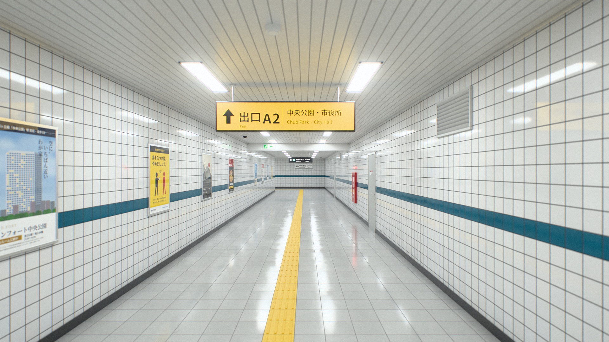
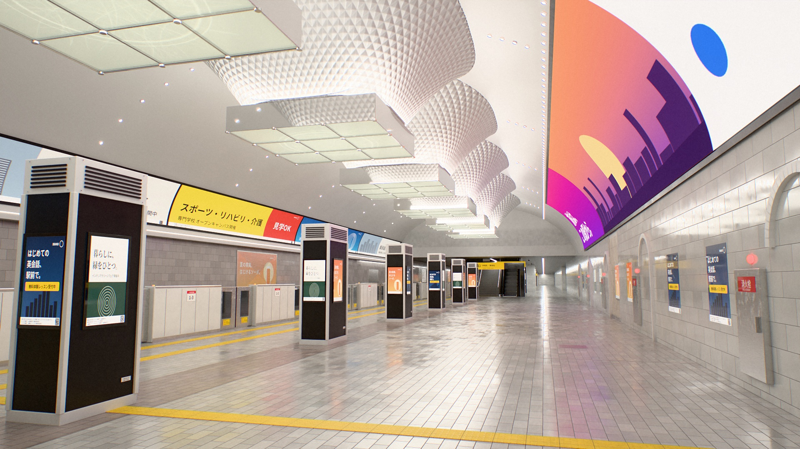
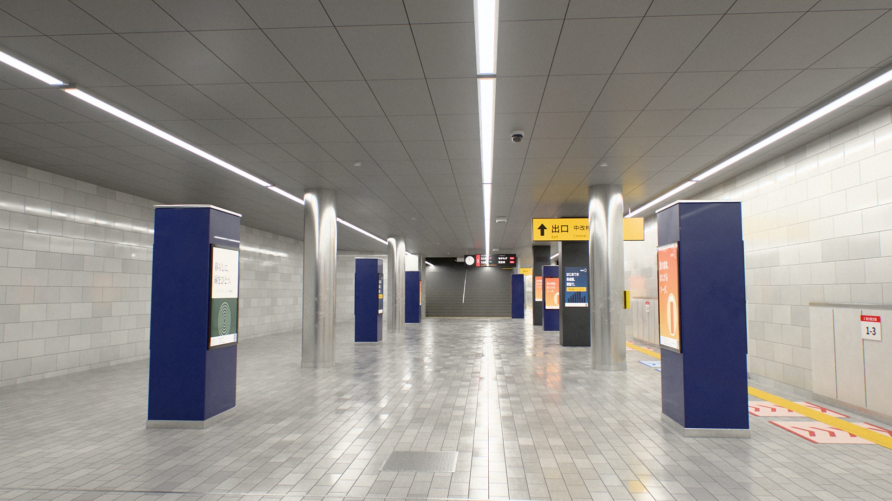
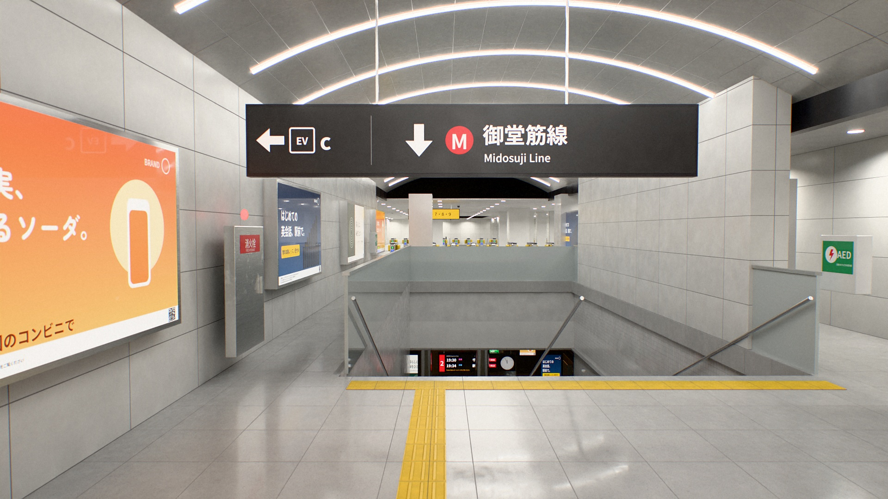
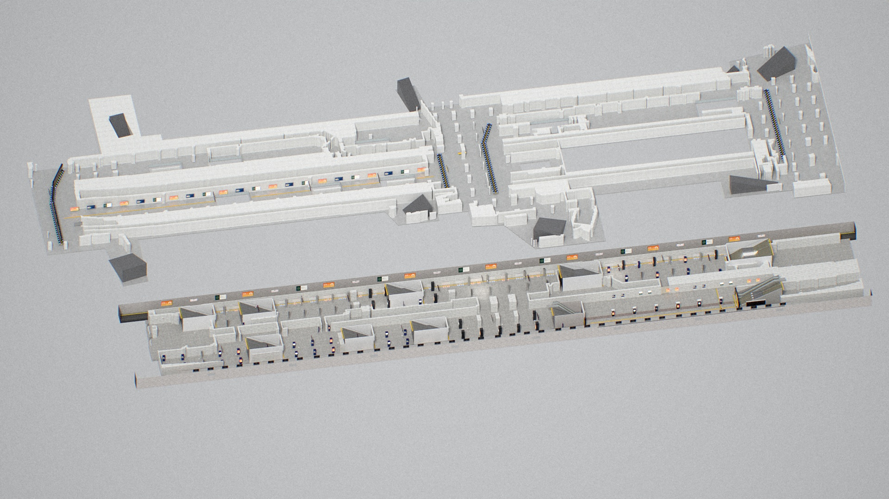

# inside-the-station

日本の地下鉄駅にある白タイルの連絡通路を、Blender（Cycles パストレーサ）でコードから生成した静止画です。
空間・素材・照明・ポスター・看板はすべてこのリポジトリのスクリプトで作っています。
3Dモデル素材、テクスチャ素材、写真は使っていません。
ポスターと看板は架空の「陽ヶ丘地下鉄」のものとしてデザインしたオリジナルです。



## 構成

| ファイル | 内容 |
|---|---|
| `scripts/textures.py` | タイル・床・天井・点字ブロックの質感（色・粗さ・法線）を numpy で生成します。タイルの丸い縁、1枚ごとの傾きや色のばらつき、目地の凹み、壁下部の汚れ、床の擦れ跡を含みます |
| `scripts/graphics.py` | ポスター6種、出口看板、乗換看板、誘導灯、扉の表示板、消火栓の表示を Pillow で描画します |
| `scripts/build_scene.py` | 通路・設備・照明・カメラを組み立てて Cycles でレンダリングします（出力は線形 EXR） |
| `scripts/post.py` | 発光のにじみ、レンズのベール、色収差、周辺減光をかけたあとトーンマッピングし、粒子感を加えます |

## 再現手順

```bash
pip install bpy==5.3.0 numpy scipy pillow
scripts/fetch_fonts.sh                      # Noto Sans/Serif JP など（OFL）
cd scripts
python3 build_scene.py --out ../render/corridor.exr --width 1920 --samples 400 --noise 0.008 --texres 4096
python3 post.py ../render/corridor.exr ../render/corridor.png --exposure -0.5 --view "Khronos PBR Neutral" --look None
```

GPU のない4コアの CPU で、1920×1080・400サンプルのレンダリングに約40分かかりました（実測2357秒）。

---

# 梅田駅（Osaka Metro 御堂筋線）の再現

Osaka Metro が公開している公式の駅構内図で、間取り（壁・柱・階段・改札・出入口の位置）を決めました。
内装・設備・照明は、実際の梅田駅の写真を見ながら作り直しました。
各カメラは、参照した写真とほぼ同じ位置と向きに置いています。

| 場所 | 参照した写真 |
|---|---|
|  2番線南側のアーチ天井（北を向いて撮影） | Commons「大阪メトロ梅田駅2番線ホーム2.jpg」ほか |
|  J階段の踊り場から見たアーチ側ホーム | Wikipedia「新大阪・箕面萱野方面ホーム（改修後）」 |
|  1番線側（平天井の部分） | Wikipedia「なかもず方面ホーム」 |
|  北改札内の通路と H階段 | Wikipedia「改札内コンコース」 |
|  北改札 | Wikipedia「北改札」 |

## 元にした資料

| 資料 | 使った内容 |
|---|---|
| Osaka Metro「避難確保・浸水防止計画 御堂筋線 梅田駅」(2018) 9ページ「駅構内 避難経路図」 | 壁・柱・部屋の平面形、階段 A〜J、改札の列、出入口の位置。B1 の吹き抜け（アーチ天井が B1 まで上がっている部分）の範囲から、アーチの南北の範囲を決めました（J階段の上まで続く） |
| Wikipedia「梅田駅 (Osaka Metro)」の本文 | ホーム幅 24.5 m、有効長 197 m / 201 m。2015年の2番線南側アーチ天井の改修（照明の LED 化、ホーム中央部のデジタルサイネージ）。2019年の LED スクリーン（40 m × 4 m）。2021年の可動式ホーム柵 |
| Wikipedia の同記事の写真ギャラリー、Wikimedia Commons の「Umeda Station (Osaka Metro)」カテゴリの写真（2019〜2024年撮影） | アーチ天井の形と仕上げ、ステンレス鏡面の照明箱、サイネージ柱、線路側の壁タイル、ホーム柵、床の舗装と点字ブロック、J階段の黒い門型フレームと案内表示、1番線側の天井・照明・丸柱・発車標、北改札内通路のボールト天井と光のリング、改札機と改札上の表示 |
| @DIME「御堂筋線と振り返る大阪の地下鉄の魅力」(2018) の写真 | 2番線の線路側の壁と、アーチ下部の広告帯 |

写真は形・色・配置を確かめる参考として見ただけで、リポジトリには含めていません。
写真から読み取ったことは次のとおりです。

- アーチ天井：楕円形のヴォールトの頂部に、ステンレス鏡面の照明箱（約3.6 m 角、底面は 3×3 枠のエッチングガラス）が一列に吊られています。照明箱は、地図にあるサイネージ柱の真上に並びます。
  - 各照明箱から天井へ、漏斗（ラッパ）状の殻が広がります。殻は白いピラミッド形レリーフで覆われ、レリーフの列は照明箱から放射状に並びます。
  - 隣り合う殻は、曲線の折れ目で接しています。
  - 残りの部分は白い平パネルで、小さな丸いダウンライトが付いています。
  - `scripts/umeda/umeda_vault.py` は、この形を式で作っています。ピラミッドの列は照明箱を中心とする対数極座標に並べ、ひし形向きにしました。
- アーチの下には柱がなく、地図の小さな四角6つは独立したデジタルサイネージ柱です（黒い本体、白い枠、上部にルーバー）。
- LED スクリーンは中央壁側のアーチ曲面にあり、その下はアーチ形の開口がある壁です。線路側は、大判タイルの壁の上のアーチ下部に、横長の広告帯があります。

## 地図から自動で取ったもの・手で指定したもの

- **自動**（`scripts/umeda/plan.py`）：赤い避難経路と文字を消した線画から、通れる床を塗りつぶしで求めます。それ以外の壁・柱・部屋をそのまま多角形にして立ち上げています。
  小さな四角は、大きさで丸柱・サイネージ柱・角柱に分けています。
- **手で指定**：階段 A〜J の範囲と昇り方向（地図の矢印から判断）、改札機の列、出入口の階段の向き、B1 の外周（地下街へ続く端を切るため）、アーチ天井の範囲です。

縮尺は1ピクセルあたり 0.187 m です。地図上のホーム幅をホーム幅の公表値に合わせて決めました。
この縮尺だとホームの長さは約 204 m / 215 m となり、有効長の公表値とも合います。

`render/umeda_top.png` は、地図と同じ縮尺・同じ配置で真上から撮った3Dモデルです。
`scripts/umeda/compare.py` を実行すると、地図の線を重ねた比較画像ができます（地図そのものを含むため、比較画像はリポジトリに入れていません）。



## 推定であるもの（地図にも公表値にもない）

- 高さ：コンコース天井 3.0 m、ホーム床は B1 から −5.8 m、平天井はホーム床から 3.6 m、アーチの頂部は 8.05 m、照明箱の下面は 4.9 m（いずれも写真の人やサイネージ柱の大きさから見積もり）
- 寸法の細部：照明箱・サイネージ柱・改札機・ホーム柵の寸法、タイルの大きさ
- 広告、LED スクリーンとサイネージの映像は架空のものです。駅名標・番線案内・改札名・発車標は、実際の表示の内容と配置にならって描いています。
- 人と電車はいません。

## 再現手順

```bash
scripts/umeda/fetch_map.sh                  # 公式PDFを取得し、9ページの図を cache/umeda/map.png に保存
python3 scripts/umeda/plan.py               # 地図を3D用の多角形に変換 → cache/umeda/plan.json
cd scripts/umeda
for v in arch stairtop track1 concourse gate; do
  python3 build_umeda.py --view $v --out ../../render/umeda_$v.exr --width 1920 --samples 96 --noise 0.02
done
python3 build_umeda.py --view top      --out ../../render/umeda_top.exr      --width 1440 --samples 48
python3 build_umeda.py --view overview --out ../../render/umeda_overview.exr --width 1920 --samples 96 --noise 0.02
cd .. && python3 post.py ../render/umeda_arch.exr ../render/umeda_arch.png --exposure -0.9 --view "Khronos PBR Neutral" --look None
# 構図の検討用：低解像度で複数のカメラ位置を一度に描画（x,y,z,上下角,方位角,焦点距離）
python3 umeda/build_umeda.py --view arch --width 480 --samples 8 "--multi=88.5,-1.6,-4.3,6,105,24;95.35,-7.6,-1.86,-21,90,16"
```

`pip install opencv-python-headless` も必要です。
GPU のない4コアの CPU では、1920×1080 の1枚（160サンプル）に約40分かかります。
環境が途中で再起動しても続きから描けるよう、`scripts/umeda/render_strips.py` で6本の帯に分けて描き、あとでつなぐこともできます。

### Kaggle の GPU で描画する（掲載している5枚はこの方法、512サンプル）

```bash
pip install kaggle                                   # Kaggle の API トークンが必要
python3 scripts/kaggle/kaggle_render.py bundle       # スクリプト・フォント・テクスチャを非公開データセットとしてアップロード
python3 scripts/kaggle/kaggle_render.py run arch stairtop track1 concourse gate --samples 512 --noise 0.008
cd scripts && python3 post.py ../render/umeda_arch.exr ../render/umeda_arch.png --exposure -0.9 --grain 0.8 --view "Khronos PBR Neutral" --look None
```

Kaggle の無料 GPU（Tesla T4 ×2、OptiX）では、160サンプルの1枚が84秒で描けました（上の CPU の約28倍）。
512サンプルの5枚をまとめて描くと、準備を含めて約24分です。
公式の構内図と参考写真はアップロードしません。描画に使うのは、地図から作った `plan.json` だけです。
